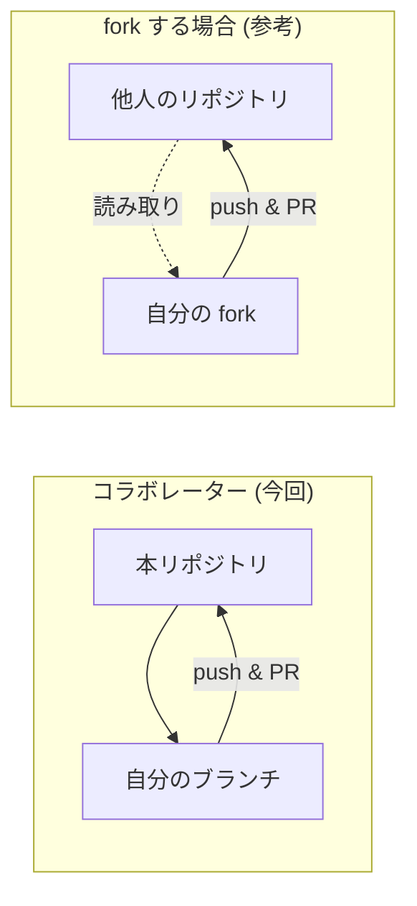

# 04. Git / GitHub ハンズオン (Cursor) 

所要の目安: **約35分** (PR 課題 4 ステップ全体は [submissions/README.md](../submissions/README.md) に従い、ペアワーク込みで時間配分)

全員が **clone → ブランチ → 編集 → commit → push → Pull Request (PR)** に加え、**レビュー・pull・コンフリクト解消** まで体験します。UI は **Cursor のソース管理 (Source Control)** を中心に説明します。必要なところだけターミナルコマンドも載せます。

---

## 0. 用語の整理

| 用語 | ざっくり意味 |
|------|----------------|
| **リポジトリ** | プロジェクトのフォルダ + 履歴 (GitHub 上) |
| **clone** | リポジトリのコピーを自分の PC に作る |
| **branch** | 並行して作業するための「枝」 |
| **commit** | 変更の保存ポイント (スナップショット) |
| **push** | 自分の commit を GitHub に送る |
| **PR** | 「この枝を main に取り込んでください」という提案 |
| **タグ** | 特定のコミットに付ける版の目印 (詳細は [06_tags_releases.md](06_tags_releases.md)) |

PR 課題の 4 ステップ (自分の PR → ペアレビュー → pull で取り込み → `members.md` でコンフリクト) は [submissions/README.md](../submissions/README.md) にまとめています。

### Public 教材と Private ハンズオン

- **公開教材**: [daihiko-lab/JuliaGitHubCursorIntro.jl](https://github.com/daihiko-lab/JuliaGitHubCursorIntro.jl) (Public。旧 URL からリダイレクトされます) 
- **当日の演習**: オーナーが複製した **Private リポジトリ** で PR を出します。clone する URL は **オーナーの案内** に従ってください (テンプレート複製か Organization 内コピーか等はオーナーが選択します) 

以下の手順では、`<ハンズオン用リポジトリの URL>` をオーナーから受け取った clone URL に置き換えてください。

---

## 1. リポジトリを clone する

### Cursor の UI

1. **Command Palette** (`Ctrl+Shift+P` / Mac は `Cmd+Shift+P`) 
2. 「Git: Clone」を選ぶ
3. `<ハンズオン用リポジトリの URL>` を入力 (SSH を使う人は SSH URL) 
4. 保存先フォルダを選ぶ
5. 「開く」でワークスペースとして開く

### ターミナル

```bash
cd 作業したい親フォルダ
git clone <ハンズオン用リポジトリの URL>
cd <clone したフォルダ名>
```

初回だけ GitHub へのログインを求められることがあります (ブラウザ認証など) 。

(予習) 公開版のみ読みたい場合: `git clone https://github.com/daihiko-lab/JuliaGitHubCursorIntro.jl.git`

---

## 2. 最新の `main` を確認する

```bash
git switch main
git pull origin main
```

Cursor 左サイドバーの **Source Control** アイコン (分岐マーク) でもブランチ名を確認できます。

---

## 3. 作業用ブランチを作る

ブランチ名は分かりやすく (例: `feat/mean-yourusername`) 。

### Cursor

1. 画面左下の **現在のブランチ名** をクリック
2. 「Create new branch…」
3. 名前を入力 → 作成

### ターミナル

```bash
git switch -c feat/mean-yourusername
```

---

## 4. ファイルを編集する

**ステップ 1** として `submissions/<GitHubユーザー名>.jl` を **新規作成** します (詳細は [submissions/README.md](../submissions/README.md)) 。

### 書く内容 (例)

- 平均関数: `my_mean(x) = sum(x) / length(x)` 程度でよい
- 末尾に呼び出し例 (例: `my_mean([1, 2, 3, 4, 5])`) を置くと、CI が `include` したときにも動作確認しやすい

Julia の編集は Cursor 上で問題ありません。

### Runic (書式) に CI が落ちたとき

PR を出すと **Runic** ジョブが走ります。ローカルで直す例:

```bash
julia -e 'using Pkg; Pkg.add("Runic"); using Runic; Runic.main("submissions/yourusername.jl")'
```

表示に従って書式を直し、再度 commit → push します。CI 全体の見方は [docs/05_ci.md](05_ci.md) です。

---

## 5. commit する

### Cursor (Source Control) 

1. 左サイドバー **Source Control**
2. 変更ファイルの横の **+** でステージ (Stage) 
3. 上のメッセージ欄にコミットメッセージ (例: `Add my_mean submission for yourusername`) 
4. **Commit** ボタン

### ターミナル

```bash
git add submissions/yourusername.jl
git commit -m "Add my_mean submission for yourusername"
```

---

## 6. push する

初めてそのブランチを送るとき:

### Cursor

「Publish Branch」や「Sync / Push」の提案が出たらそれに従う。

### ターミナル

```bash
git push -u origin feat/mean-yourusername
```

---

## 7. Pull Request を作る

1. ブラウザで GitHub のリポジトリを開く
2. push 直後に出る **「Compare & pull request」** バナーをクリック (出ない場合は Pull requests → New) 
3. **base: `main`** ← **compare: あなたのブランチ** になっているか確認
4. タイトル・説明を書いて **Create pull request**

オーナーがレビューし、問題なければ **Merge** します (参加者は merge ボタンを押さなくて OK な場合が多いですが、ゼミの指示に従ってください) 。

---

## 8. ペアで相手の PR をレビューする

**ステップ 2** です。ペアになった相手の PR を開き、フィードバックします。

### GitHub 上でできること

- **Conversation** タブでコメント
- **Files changed** タブで行単位のコメント
- **Start a review** → **Suggest changes** で、相手が「Commit suggestion」できる修正案を出す

レビューの例: ドキュメント文字列を足す、空配列でエラーを出す、変数名を分かりやすくする、など。

### 相手のブランチに直接 commit する (任意)

コラボレーターは相手のブランチにも push できます (相手に一声かけてから) 。

```bash
git fetch origin
git switch feat/mean-partnerusername
# 編集後
git add submissions/partnerusername.jl
git commit -m "Suggest docstring for my_mean (pair review)"
git push origin feat/mean-partnerusername
```

相手は次の §9 で取り込みます。

---

## 9. レビューで直された自分の PR を取り込む

**ステップ 3** です。相手 (または自分) が **リモートのブランチに新しい commit** を足したあと、作者の手元を同期します。

### 基本手順

```bash
git switch feat/mean-yourusername
git pull origin feat/mean-yourusername
```

差分を確認してから、必要なら追加編集 → commit → push:

```bash
git push origin feat/mean-yourusername
```

### push が拒否される (non-fast-forward) 

手元の履歴がリモートより古いと、次のようなエラーになります。

```text
! [rejected] ... (non-fast-forward)
```

**対処**: `git pull` (必要ならコンフリクトを解消) してから、もう一度 `git push` します。**`git push --force` は使わない** でください (ゼミルール) 。

Cursor では **Sync** や pull の提案に従っても構いません。

---

## 10. コンフリクトを解消する (`members.md`)

**ステップ 4** です。[`submissions/members.md`](../submissions/members.md) の **表の末尾** に、各自が1行追加します。複数の PR が `main` に取り込まれる途中だと、**同じ付近の編集** がぶつかり **conflict** します。今回は **意図して体験** する設計です。

### コンフリクトマーカー

ファイル中に次のような印が出ます。

```text
<<<<<<< HEAD
| あなたの行 |
=======
| 先にマージされた相手の行 |
>>>>>>> origin/main
```

**マーカー行はすべて削除** し、表として正しい形 (ふたつの行を残すなど) に直します。

### 解消のしかた (いずれか)

| 方法 | 操作のイメージ |
|------|----------------|
| **Cursor** | マージエディタや diff ビューで「Accept」系の操作を選び、保存 |
| **ターミナル** | `git fetch origin` のあと `git merge origin/main` (または rebase) 。エディタで直して `git add submissions/members.md` → `git commit` |
| **GitHub** | PR 画面の **Resolve conflicts** で Web エディタを開き、直して **Mark as resolved** → commit |

解消後は `git push` して PR を更新し、CI が通ることを確認します。

`main` を取り込むタイミングはオーナー指示に従ってください (全員同時にマージすると慌ただしいため) 。

---

## コラム: fork について (今回は使わない) 

### fork とは

**書き込み権限のないリポジトリ** に変更を提案するとき、自分のアカウント配下に **コピー (fork)** を作り、そこからブランチを切って PR を出す方法が一般的です。

### 今回

あなたは **コラボレーター** なので、**fork せず** 本家リポジトリに直接ブランチを push できます。



| | コラボレーター | fork して PR |
|---|----------------|--------------|
| リポジトリの場所 | 本家に branch | 自分の fork に branch |
| 権限 | 書き込み可 | 本家は読み取りのみ |
| 今回 | **これ** | 使わない |

---

## 次のステップ

PR を出したら [docs/05_ci.md](05_ci.md) を見ながら **CI の結果** を確認しましょう。4 ステップのチェックリストは [submissions/README.md](../submissions/README.md) です。
