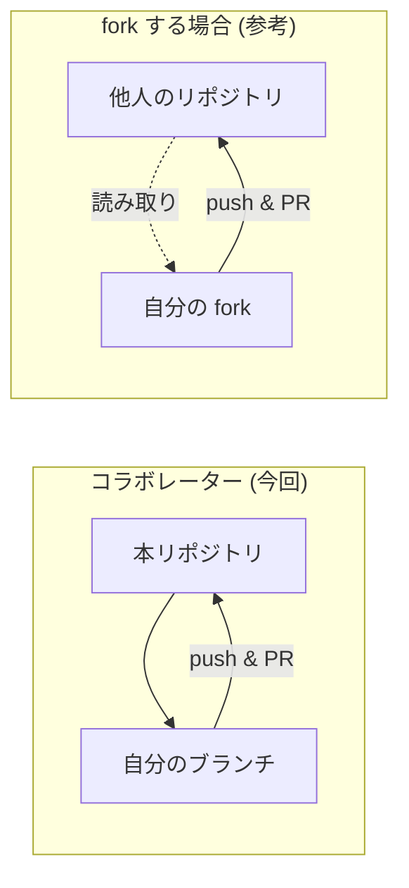

# 04. Git / GitHub ハンズオン (Cursor) 

所要の目安: **約35分**

全員が **clone → ブランチ → 編集 → commit → push → Pull Request (PR)** まで体験します。UI は **Cursor のソース管理 (Source Control)** を中心に説明します。必要なところだけターミナルコマンドも載せます。

---

## 0. 用語の整理

| 用語 | ざっくり意味 |
|------|----------------|
| **リポジトリ** | プロジェクトのフォルダ + 履歴 (GitHub 上) |
| **clone** | リポジトリのコピーを自分の PC に作る |
| **branch** | 並行して作業するための「枝」 |
| **commit** | 変更の保存ポイント (スナップショット) |
| **push** | 自分の commit を GitHub に送る |
| **PR** | 「この枝を main に取り込んでください」という提案 |
| **タグ** | 特定のコミットに付ける版の目印 (詳細は [06_tags_releases.md](06_tags_releases.md)) |

今回の PR 課題の詳細は [submissions/README.md](../submissions/README.md) です。

### Public 教材と Private ハンズオン

- **公開教材**: [daihiko-lab/JuliaGitHubCursorIntro.jl](https://github.com/daihiko-lab/JuliaGitHubCursorIntro.jl) (Public。旧 URL からリダイレクトされます) 
- **当日の演習**: オーナーが複製した **Private リポジトリ** で PR を出します。clone する URL は **オーナーの案内** に従ってください (テンプレート複製か Organization 内コピーか等はオーナーが選択します) 

以下の手順では、`<ハンズオン用リポジトリの URL>` をオーナーから受け取った clone URL に置き換えてください。

---

## 1. リポジトリを clone する

### Cursor の UI

1. **Command Palette** (`Ctrl+Shift+P` / Mac は `Cmd+Shift+P`) 
2. 「Git: Clone」を選ぶ
3. `<ハンズオン用リポジトリの URL>` を入力 (SSH を使う人は SSH URL) 
4. 保存先フォルダを選ぶ
5. 「開く」でワークスペースとして開く

### ターミナル

```bash
cd 作業したい親フォルダ
git clone <ハンズオン用リポジトリの URL>
cd <clone したフォルダ名>
```

初回だけ GitHub へのログインを求められることがあります (ブラウザ認証など) 。

(予習) 公開版のみ読みたい場合: `git clone https://github.com/daihiko-lab/JuliaGitHubCursorIntro.jl.git`

---

## 2. 最新の `main` を確認する

```bash
git switch main
git pull origin main
```

Cursor 左サイドバーの **Source Control** アイコン (分岐マーク) でもブランチ名を確認できます。

---

## 3. 作業用ブランチを作る

ブランチ名は分かりやすく (例: `feat/intro-あなたのユーザー名`) 。

### Cursor

1. 画面左下の **現在のブランチ名** をクリック
2. 「Create new branch…」
3. 名前を入力 → 作成

### ターミナル

```bash
git switch -c feat/intro-yourusername
```

---

## 4. ファイルを編集する

PR 課題として `submissions/あなたのGitHubユーザー名.jl` を **新規作成** します (中身は [submissions/README.md](../submissions/README.md) 参照) 。

Julia の編集は Cursor 上で問題ありません。

---

## 5. commit する

### Cursor (Source Control) 

1. 左サイドバー **Source Control**
2. 変更ファイルの横の **+** でステージ (Stage) 
3. 上のメッセージ欄にコミットメッセージ (例: `Add submission script for yourusername`) 
4. **Commit** ボタン

### ターミナル

```bash
git add submissions/yourusername.jl
git commit -m "Add submission script for yourusername"
```

---

## 6. push する

初めてそのブランチを送るとき:

### Cursor

「Publish Branch」や「Sync / Push」の提案が出たらそれに従う。

### ターミナル

```bash
git push -u origin feat/intro-yourusername
```

---

## 7. Pull Request を作る

1. ブラウザで GitHub のリポジトリを開く
2. push 直後に出る **「Compare & pull request」** バナーをクリック (出ない場合は Pull requests → New) 
3. **base: `main`** ← **compare: あなたのブランチ** になっているか確認
4. タイトル・説明を書いて **Create pull request**

オーナーがレビューし、問題なければ **Merge** します (参加者は merge ボタンを押さなくて OK な場合が多いですが、ゼミの指示に従ってください) 。

---

## 8. コンフリクトについて (軽く) 

同じ行を複数人が編集すると **conflict** することがあります。今回は **各自別ファイル** の PR なので起きにくい設計です。もし出たら、その場ではオーナーか TA に相談してください。

---

## コラム: fork について (今回は使わない) 

### fork とは

**書き込み権限のないリポジトリ** に変更を提案するとき、自分のアカウント配下に **コピー (fork)** を作り、そこからブランチを切って PR を出す方法が一般的です。

### 今回

あなたは **コラボレーター** なので、**fork せず** 本家リポジトリに直接ブランチを push できます。



| | コラボレーター | fork して PR |
|---|----------------|--------------|
| リポジトリの場所 | 本家に branch | 自分の fork に branch |
| 権限 | 書き込み可 | 本家は読み取りのみ |
| 今回 | **これ** | 使わない |

---

## 次のステップ

PR を出したら [docs/05_ci.md](05_ci.md) を見ながら **CI の結果** を確認しましょう。
